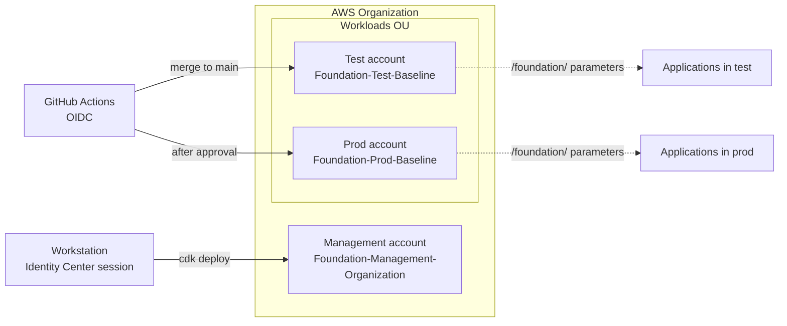

# aws-foundation

AWS Organization baseline for the `nathanreed.dev` projects: accounts and guardrails, sign-in through IAM Identity Center, GitHub deployment roles, DNS, and budgets. Application repositories build on it through a small contract of SSM parameters.

**Status:** the management stack defines the organization trail, service control policies, root sign-in alert, budgets, and cost anomaly detection. The test and prod baseline stacks define the GitHub OIDC deployment roles and are deployed by GitHub Actions. DNS is added next.

## Accounts

| Account | Purpose | Changed by |
|---|---|---|
| Management | Organization, Identity Center, billing, budgets, organization trail, domain registration | Manual deploys from a workstation |
| Test | Test stage of every application, `test.nathanreed.dev` zone | GitHub Actions on merge to `main` |
| Prod | Production stage of every application, `nathanreed.dev` zone | GitHub Actions after approval |

## What this repository manages

- Service control policies and an organization CloudTrail trail
- Budgets and cost anomaly detection
- GitHub OIDC deployment roles for each application repository
- Hosted zones for `nathanreed.dev` and `test.nathanreed.dev`
- SSM parameters under `/foundation/` that applications read at deploy time

## Contract for applications

Applications read these parameters in their own account and never reference foundation resources directly.

| Parameter | Value |
|---|---|
| `/foundation/dns/zone-name` | The account's hosted zone name |
| `/foundation/dns/zone-id` | The account's hosted zone ID |

Changing or removing a parameter is a breaking change: the replacement is added first, consumers migrate, and the original is removed last.

## Architecture



| Stack | Account | Contains |
|---|---|---|
| `Foundation-Management-Organization` | Management | Service control policies, organization trail, budgets, cost anomaly detection |
| `Foundation-Test-Baseline` | Test | GitHub OIDC provider and deployment roles; later the `test.nathanreed.dev` zone and `/foundation/` parameters |
| `Foundation-Prod-Baseline` | Prod | GitHub OIDC provider and deployment roles, `nathanreed.dev` zone, `/foundation/` parameters |

```
bin/app.ts        Entry point: management stack and test/prod stages
lib/config.ts     Typed configuration; account IDs from environment variables
lib/stacks/       Management and account baseline stacks
lib/stages/       Stage for each workload account
lib/constructs/   Budgets, anomaly alerts, trail, SCPs, root sign-in alert, deployment roles
test/             Assertion tests
docs/adr/         Architecture decision records
docs/standards/   Synced from engineering-standards
```

## Key decisions

- **Decisions are recorded as ADRs** in [`docs/adr/`](docs/adr), starting with [0001](docs/adr/0001-record-architecture-decisions.md).
- **Account IDs and the cost alert address come from environment variables**, never source (see [Workstation variables](#workstation-variables)). An environment without an account ID is left out of the app, so a deploy can only target the accounts it was given.
- **The `nathanreed.dev` zone lives in prod** ([ADR 0007](docs/adr/0007-prod-hosted-zone.md)), with the records copied from the zone the domain registration created in the management account. The home lab address comes from `SERVER_IP_ADDRESS`, not source. See [DNS](#dns).
- **Guardrails apply to the `Workloads` OU** ([ADR 0004](docs/adr/0004-organization-guardrails.md)). Two service control policies deny leaving the organization, changing the organization trail, root user actions outside centralized root access, and actions outside `us-east-1` other than global services. An organization trail records management events from every account.
- **Budgets and anomaly alerts track gross spend** ([ADR 0003](docs/adr/0003-budgets-and-cost-anomaly-detection.md)). Credits and refunds are excluded, and one customer managed anomaly monitor covers all three accounts.
- **GitHub Actions deploy through one OIDC role per repository and account** ([ADR 0005](docs/adr/0005-github-oidc-deployment-roles.md)). A role trusts only its repository's immutable OIDC subject, `repo:<owner>@<owner-id>/<repo>@<repo-id>:environment:<test|prod>` ([ADR 0008](docs/adr/0008-immutable-oidc-subjects.md)), and can only assume the CDK bootstrap roles. See [Deployment roles](#deployment-roles).
- **A push to `main` deploys test, then prod after approval** ([ADR 0006](docs/adr/0006-deploy-workload-stacks-from-github-actions.md)), through the `Deploy` workflow. Each job synthesizes only its own account's stage.
- **The management stack is deployed only from a workstation** ([ADR 0002](docs/adr/0002-deploy-management-stack-from-workstation.md)). CI has no access to the management account, and every account's bootstrap roles trust only that account.
- **Node.js runs the TypeScript directly** through its built-in type stripping, so there is no compile step or TypeScript runner. Code uses only erasable syntax (no enums, namespaces, or parameter properties), and relative imports end in `.ts`. `tsc` runs as a type check only.
- **cdk-nag runs as a CDK policy validation plugin.** Any `AwsSolutions` finding fails synthesis. Acknowledge a finding on the specific resource, with a reason:

  ```ts
  Validations.of(bucket).acknowledge({
    id: 'AwsSolutions::AwsSolutions-S1',
    reason: 'This bucket is the access log destination.',
  });
  ```

- **Tags are set on every stack**: `Project`, `Environment`, and `Repository`. CloudFormation propagates stack tags to resources, so they work as cost allocation tags.

## Local development

Prerequisites:

- Node.js 24 (see `.nvmrc`). On Windows: `winget install OpenJS.NodeJS.24`
- AWS CLI v2 with the `management`, `test`, and `prod` Identity Center profiles from the AWS account setup runbook

```bash
npm ci
```

| Command | Purpose |
|---|---|
| `npm run format` | Format with Prettier |
| `npm run format:check` | Check formatting |
| `npm run lint` | Lint with ESLint |
| `npm run typecheck` | Type check with `tsc` |
| `npm test` | Run the assertion tests |
| `npm run synth` | Synthesize the environments that have account IDs set |

Synthesis needs at least one account ID. Example values are enough to check the templates:

```bash
MANAGEMENT_ACCOUNT_ID=111122223333 TEST_ACCOUNT_ID=444455556666 PROD_ACCOUNT_ID=777788889999 \
  COST_ALERT_EMAIL=costs@example.com SECURITY_ALERT_EMAIL=security@example.com \
  ORGANIZATION_ID=o-a1b2c3d4e5 WORKLOADS_OU_ID=ou-a1b2-c3d4e5f6 SERVER_IP_ADDRESS=192.0.2.10 npm run synth
```

### Workstation variables

| Variable | Needed for |
|---|---|
| `MANAGEMENT_ACCOUNT_ID` | Management stack; requires all the others |
| `TEST_ACCOUNT_ID` | Test stage and management budgets |
| `PROD_ACCOUNT_ID` | Prod stage and management budgets |
| `COST_ALERT_EMAIL` | Budget and anomaly alerts |
| `SECURITY_ALERT_EMAIL` | Root sign-in alerts |
| `ORGANIZATION_ID` | Organization trail (`o-...`) |
| `WORKLOADS_OU_ID` | Target of the service control policies (`ou-...`) |
| `SERVER_IP_ADDRESS` | `server.nathanreed.dev` in the prod zone; required with `PROD_ACCOUNT_ID` |

Set them for the current shell before bootstrapping or deploying from a workstation. Replace the email addresses and the home lab address (`192.0.2.10`) with your own.

Bash:

```bash
export MANAGEMENT_ACCOUNT_ID=$(aws sts get-caller-identity --profile management --query Account --output text)
export TEST_ACCOUNT_ID=$(aws sts get-caller-identity --profile test --query Account --output text)
export PROD_ACCOUNT_ID=$(aws sts get-caller-identity --profile prod --query Account --output text)
export COST_ALERT_EMAIL=costs@example.com
export SECURITY_ALERT_EMAIL=security@example.com
export ORGANIZATION_ID=$(aws organizations describe-organization --profile management --query Organization.Id --output text)
root_id=$(aws organizations list-roots --profile management --query 'Roots[0].Id' --output text)
export WORKLOADS_OU_ID=$(aws organizations list-organizational-units-for-parent --profile management --parent-id "$root_id" --query "OrganizationalUnits[?Name=='Workloads'].Id" --output text)
export SERVER_IP_ADDRESS=192.0.2.10
```

PowerShell:

```powershell
$env:MANAGEMENT_ACCOUNT_ID = aws sts get-caller-identity --profile management --query Account --output text
$env:TEST_ACCOUNT_ID = aws sts get-caller-identity --profile test --query Account --output text
$env:PROD_ACCOUNT_ID = aws sts get-caller-identity --profile prod --query Account --output text
$env:COST_ALERT_EMAIL = 'costs@example.com'
$env:SECURITY_ALERT_EMAIL = 'security@example.com'
$env:ORGANIZATION_ID = aws organizations describe-organization --profile management --query Organization.Id --output text
$rootId = aws organizations list-roots --profile management --query 'Roots[0].Id' --output text
$env:WORKLOADS_OU_ID = aws organizations list-organizational-units-for-parent --profile management --parent-id $rootId --query "OrganizationalUnits[?Name=='Workloads'].Id" --output text
$env:SERVER_IP_ADDRESS = '192.0.2.10'
```

## Testing

Tests use Vitest against the synthesized app, with `aws-cdk-lib/assertions` for template properties. They need no AWS credentials or network access. They cover configuration validation, stack placement and tags, that cdk-nag blocks non-compliant resources in every stack, budgets and anomaly alerts, the SCP statements and their attachment, the trail and its bucket's encryption, public access block, TLS policy, and expiration, the root sign-in alert, the deployment roles' trust conditions and permissions, and the prod zone's records, retention, and `/foundation/dns/` parameters. The test app loads the feature flags from `cdk.json`, so tests see the same templates as `cdk synth`.

Pull requests run three checks: `Quality` (format, lint, type check), `Tests`, and `Synth` (`cdk synth` with cdk-nag, using example account IDs). Pushes to `main` run the `Deploy` workflow (see [Deployment](#deployment)).

## Bootstrapping

Each account is bootstrapped once, in `us-east-1`, with an Identity Center `AdministratorAccess` session. No `--trust` option is passed, so the bootstrap roles trust only their own account. GitHub deployment roles in test and prod are created in the same account and need no cross-account trust. See [ADR 0002](docs/adr/0002-deploy-management-stack-from-workstation.md).

Run the commands from the repository root with Node.js 24 and dependencies installed (`npm ci`). `cdk bootstrap` runs the app, so set the [workstation variables](#workstation-variables) first, even though the target accounts are given explicitly.

Bash:

```bash
aws sso login --profile management
```

```bash
for profile in management test prod; do
  account=$(aws sts get-caller-identity --profile "$profile" --query Account --output text)
  npx cdk bootstrap "aws://$account/us-east-1" --profile "$profile" --termination-protection
done
```

PowerShell:

```powershell
aws sso login --profile management
```

```powershell
foreach ($p in 'management', 'test', 'prod') {
  $account = aws sts get-caller-identity --profile $p --query Account --output text
  npx cdk bootstrap "aws://$account/us-east-1" --profile $p --termination-protection
}
```

Confirm each account has a `CDKToolkit` stack in `CREATE_COMPLETE` or `UPDATE_COMPLETE`:

```bash
for profile in management test prod; do
  aws cloudformation describe-stacks --stack-name CDKToolkit --profile "$profile" --region us-east-1 --query 'Stacks[0].StackStatus' --output text
done
```

```powershell
foreach ($p in 'management', 'test', 'prod') {
  aws cloudformation describe-stacks --stack-name CDKToolkit --profile $p --region us-east-1 --query 'Stacks[0].StackStatus' --output text
}
```

Bootstrap again with the same commands when a CDK release requires a newer bootstrap version.

## Organization setup

One-time steps in the management account, before the first deploy of the guardrails. Run them with the `management` profile.

1. **Enable service control policies.** Check the root's policy types:

   ```bash
   aws organizations list-roots --profile management --query 'Roots[0].[Id,PolicyTypes]'
   ```

   If `SERVICE_CONTROL_POLICY` is not listed as `ENABLED`, enable it with the root ID (`r-...`) from that output:

   ```bash
   aws organizations enable-policy-type --profile management --root-id r-a1b2 --policy-type SERVICE_CONTROL_POLICY
   ```

2. **Give CloudTrail trusted access to the organization**, which an organization trail needs. Check, then enable if `cloudtrail.amazonaws.com` is not listed:

   ```bash
   aws organizations list-aws-service-access-for-organization --profile management
   ```

   ```bash
   aws organizations enable-aws-service-access --profile management --service-principal cloudtrail.amazonaws.com
   ```

3. **Centralized root access** (console). In the IAM console of the management account, open **Root access management** and enable root credentials management and privileged root actions for member accounts. Then, for test and prod, choose the account, **Take privileged action**, and delete the root user credentials. Confirm both features are enabled:

   ```bash
   aws iam list-organizations-features --profile management
   ```

   The `workloads-baseline` SCP denies root user actions in test and prod except for these centralized root access sessions, so privileged tasks such as unlocking a bucket policy still work.

## Deployment

**Management**, from a workstation only ([ADR 0002](docs/adr/0002-deploy-management-stack-from-workstation.md)). Deploy promptly after a change merges so the account matches `main`.

```bash
aws sso login --profile management
```

Set the [workstation variables](#workstation-variables), then:

```bash
npx cdk deploy Management --profile management
```

After the first deploy of the budgets, complete these one-time steps in the management account:

1. Activate the cost allocation tags. A key can be activated only after AWS has seen it on a resource, which can take up to 24 hours; rerun the command if a key is reported as not found.

   ```bash
   aws ce update-cost-allocation-tags-status --profile management --cost-allocation-tags-status TagKey=Project,Status=Active TagKey=Environment,Status=Active TagKey=Repository,Status=Active
   ```

2. Delete any budget created by hand before this stack existed (Billing and Cost Management → Budgets), so only the four budgets above remain.
3. Confirm the SNS subscription from the email sent to `SECURITY_ALERT_EMAIL`. Root sign-in alerts are not delivered until it is confirmed.

The root sign-in alert catches console sign-ins recorded in `us-east-1`. A sign-in through another Region's endpoint is still recorded by the trail but does not raise an alert.

**Test and prod** are deployed by the `Deploy` workflow on every push to `main` ([ADR 0006](docs/adr/0006-deploy-workload-stacks-from-github-actions.md)). The `Deploy test` job deploys `Test/*`; the `Deploy prod` job then waits for approval in the `prod` environment and deploys `Prod/*`. Each job reads `AWS_ACCOUNT_ID` and `AWS_DEPLOY_ROLE_ARN` from its GitHub environment and sets only its own account ID, so the app it synthesizes contains no management stack. The `prod` environment must require a reviewer and allow deployments only from `main`.

To deploy test or prod from a workstation instead, for example when the pipeline is unavailable, sign in with `aws sso login --profile management`, check out `main`, and run:

Bash:

```bash
TEST_ACCOUNT_ID=$(aws sts get-caller-identity --profile test --query Account --output text) \
  npx cdk deploy 'Test/*' --profile test
```

```bash
PROD_ACCOUNT_ID=$(aws sts get-caller-identity --profile prod --query Account --output text) \
  npx cdk deploy 'Prod/*' --profile prod
```

## Deployment roles

Each repository in `deploymentRepositories` (`lib/config.ts`) has a role in test and in prod ([ADR 0005](docs/adr/0005-github-oidc-deployment-roles.md)):

- The trust policy accepts only GitHub OIDC tokens with audience `sts.amazonaws.com` and the repository's immutable subject `repo:<owner>@<owner-id>/<repo>@<repo-id>:environment:<test|prod>`, so only jobs that run in that repository's matching GitHub environment can assume it.
- The role can only assume the account's CDK deploy, file publishing, and image publishing bootstrap roles. CloudFormation makes the changes.

The repositories are `aws-foundation`, `portfolio-site`, `outage-atlas`, and `nasa-rag`. To add one, add it to the list with its owner and repository IDs (the `sub_claim_prefix` from `gh api repos/<owner>/<repo>/actions/oidc/customization/sub`), deploy the test and prod baseline stacks, and set its GitHub environment variables.

After deploying a baseline stack, set the variables in each repository's GitHub environment from the stack outputs. Each repository needs `test` and `prod` environments; `prod` should require approval and allow deployments only from `main`. With the GitHub CLI, for `aws-foundation` in test:

```bash
account=$(aws sts get-caller-identity --profile test --query Account --output text)
role=$(aws cloudformation describe-stacks --stack-name Foundation-Test-Baseline --profile test --region us-east-1 \
  --query "Stacks[0].Outputs[?Description=='AWS_DEPLOY_ROLE_ARN for the test environment of nathan-a-reed/aws-foundation'].OutputValue" --output text)
gh variable set AWS_ACCOUNT_ID --repo nathan-a-reed/aws-foundation --env test --body "$account"
gh variable set AWS_DEPLOY_ROLE_ARN --repo nathan-a-reed/aws-foundation --env test --body "$role"
```

Repeat with `prod` (profile, stack `Foundation-Prod-Baseline`, environment, and output description) and with each repository name. A workflow job then authenticates with:

```yaml
environment: test
permissions:
  id-token: write
  contents: read
steps:
  - uses: aws-actions/configure-aws-credentials@<commit SHA> # <version>
    with:
      role-to-assume: ${{ vars.AWS_DEPLOY_ROLE_ARN }}
      aws-region: us-east-1
```

## DNS

The prod baseline stack defines the public `nathanreed.dev` hosted zone ([ADR 0007](docs/adr/0007-prod-hosted-zone.md)) with the records in `lib/dns/prod-zone-records.ts`: every record of the zone Route 53 created in the management account at registration, except NS and SOA. The zone is kept if the stack is deleted. Its name servers are a stack output, and the registered domain points to them after the cutover in the DNS migration runbook.

The `server` A record holds the home lab address from `SERVER_IP_ADDRESS`, which stays out of this public repository. Synthesizing the prod stage without it fails, so a deploy cannot remove the record. The `Deploy prod` job reads it from the `SERVER_IP_ADDRESS` secret in the `prod` GitHub environment; secrets are masked in the public workflow logs.

Change records only in `lib/dns/prod-zone-records.ts`. Records added by hand in the console are not tracked.

## Expected cost

Budgets without actions and Cost Anomaly Detection have no charge. The first copy of management events delivered by a trail is free, so the organization trail costs only its S3 storage, a few cents a month. CDK bootstrap adds an S3 bucket and an ECR repository per account, which cost cents while they hold little. IAM roles and OIDC providers have no charge. Once complete, the foundation is expected to cost about $1–2 per month, mostly the two Route 53 hosted zones at $0.50 each, within the $5 management budget and the workload account budgets.

## Standards

Work in this repository follows [CONTRIBUTING.md](CONTRIBUTING.md) and the shared standards in [`docs/standards/`](docs/standards), synced from [engineering-standards](https://github.com/nathan-a-reed/engineering-standards).

## License

[MIT](LICENSE)
