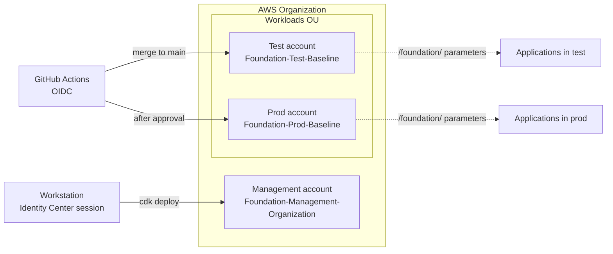

# aws-foundation

AWS Organization baseline for the `nathanreed.dev` projects: accounts and guardrails, sign-in through IAM Identity Center, GitHub deployment roles, DNS, and budgets. Application repositories build on it through a small contract of SSM parameters.

**Status:** CDK app scaffolded. The stacks are empty until guardrails, budgets, deployment roles, and DNS are added.

## Accounts

| Account | Purpose | Changed by |
|---|---|---|
| Management | Organization, Identity Center, billing, budgets, organization trail, domain registration | Manual deploys from a workstation |
| Test | Test stage of every application, `test.nathanreed.dev` zone | GitHub Actions on merge to `main` |
| Prod | Production stage of every application, `nathanreed.dev` zone | GitHub Actions after approval |

## What this repository manages

- Service control policies and an organization CloudTrail trail
- Budgets and cost anomaly detection
- GitHub OIDC deployment roles for each application repository
- Hosted zones for `nathanreed.dev` and `test.nathanreed.dev`
- SSM parameters under `/foundation/` that applications read at deploy time

## Contract for applications

Applications read these parameters in their own account and never reference foundation resources directly.

| Parameter | Value |
|---|---|
| `/foundation/dns/zone-name` | The account's hosted zone name |
| `/foundation/dns/zone-id` | The account's hosted zone ID |

Changing or removing a parameter is a breaking change: the replacement is added first, consumers migrate, and the original is removed last.

## Architecture



| Stack | Account | Contains |
|---|---|---|
| `Foundation-Management-Organization` | Management | Service control policies, organization trail, budgets, cost anomaly detection |
| `Foundation-Test-Baseline` | Test | Deployment roles, `test.nathanreed.dev` zone, `/foundation/` parameters |
| `Foundation-Prod-Baseline` | Prod | Deployment roles, `nathanreed.dev` zone, `/foundation/` parameters |

```
bin/app.ts        Entry point: management stack and test/prod stages
lib/config.ts     Typed configuration; account IDs from environment variables
lib/stacks/       Management and account baseline stacks
lib/stages/       Stage for each workload account
test/             Assertion tests
docs/adr/         Architecture decision records
docs/standards/   Synced from engineering-standards
```

## Key decisions

- **Decisions are recorded as ADRs** in [`docs/adr/`](docs/adr), starting with [0001](docs/adr/0001-record-architecture-decisions.md).
- **Account IDs come from environment variables**, never source: `MANAGEMENT_ACCOUNT_ID`, `TEST_ACCOUNT_ID`, and `PROD_ACCOUNT_ID`. An environment without an account ID is left out of the app, so a deploy can only target the accounts it was given.
- **The management stack is deployed only from a workstation** ([ADR 0002](docs/adr/0002-deploy-management-stack-from-workstation.md)). CI has no access to the management account, and every account's bootstrap roles trust only that account.
- **Node.js runs the TypeScript directly** through its built-in type stripping, so there is no compile step or TypeScript runner. Code uses only erasable syntax (no enums, namespaces, or parameter properties), and relative imports end in `.ts`. `tsc` runs as a type check only.
- **cdk-nag runs as a CDK policy validation plugin.** Any `AwsSolutions` finding fails synthesis. Acknowledge a finding on the specific resource, with a reason:

  ```ts
  Validations.of(bucket).acknowledge({
    id: 'AwsSolutions::AwsSolutions-S1',
    reason: 'This bucket is the access log destination.',
  });
  ```

- **Tags are set on every stack**: `Project`, `Environment`, and `Repository`. CloudFormation propagates stack tags to resources, so they work as cost allocation tags.

## Local development

Prerequisites:

- Node.js 24 (see `.nvmrc`). On Windows: `winget install OpenJS.NodeJS.24`
- AWS CLI v2 with the `management`, `test`, and `prod` Identity Center profiles from the AWS account setup runbook

```bash
npm ci
```

| Command | Purpose |
|---|---|
| `npm run format` | Format with Prettier |
| `npm run format:check` | Check formatting |
| `npm run lint` | Lint with ESLint |
| `npm run typecheck` | Type check with `tsc` |
| `npm test` | Run the assertion tests |
| `npm run synth` | Synthesize the environments that have account IDs set |

Synthesis needs at least one account ID. Example IDs are enough to check the templates:

```bash
MANAGEMENT_ACCOUNT_ID=111122223333 TEST_ACCOUNT_ID=444455556666 PROD_ACCOUNT_ID=777788889999 npm run synth
```

## Testing

Tests use Vitest against the synthesized app, with `aws-cdk-lib/assertions` for template properties. They need no AWS credentials or network access. They cover configuration validation, stack placement and tags, and that cdk-nag blocks non-compliant resources in every stack. Security-critical properties, such as SCP statements and trust policy conditions, are tested as they are added.

Pull requests run three checks: `Quality` (format, lint, type check), `Tests`, and `Synth` (`cdk synth` with cdk-nag, using example account IDs).

## Bootstrapping

Each account is bootstrapped once, in `us-east-1`, with an Identity Center `AdministratorAccess` session. No `--trust` option is passed, so the bootstrap roles trust only their own account. GitHub deployment roles in test and prod are created in the same account and need no cross-account trust. See [ADR 0002](docs/adr/0002-deploy-management-stack-from-workstation.md).

Run the commands from the repository root with Node.js 24 and dependencies installed (`npm ci`). `cdk bootstrap` runs the app, so the account ID variables must be set even though the target accounts are given explicitly.

Bash:

```bash
aws sso login --profile management
```

```bash
export MANAGEMENT_ACCOUNT_ID=$(aws sts get-caller-identity --profile management --query Account --output text)
export TEST_ACCOUNT_ID=$(aws sts get-caller-identity --profile test --query Account --output text)
export PROD_ACCOUNT_ID=$(aws sts get-caller-identity --profile prod --query Account --output text)
```

```bash
for profile in management test prod; do
  account=$(aws sts get-caller-identity --profile "$profile" --query Account --output text)
  npx cdk bootstrap "aws://$account/us-east-1" --profile "$profile" --termination-protection
done
```

PowerShell:

```powershell
aws sso login --profile management
```

```powershell
$env:MANAGEMENT_ACCOUNT_ID = aws sts get-caller-identity --profile management --query Account --output text
$env:TEST_ACCOUNT_ID = aws sts get-caller-identity --profile test --query Account --output text
$env:PROD_ACCOUNT_ID = aws sts get-caller-identity --profile prod --query Account --output text
```

```powershell
foreach ($p in 'management', 'test', 'prod') {
  $account = aws sts get-caller-identity --profile $p --query Account --output text
  npx cdk bootstrap "aws://$account/us-east-1" --profile $p --termination-protection
}
```

Confirm each account has a `CDKToolkit` stack in `CREATE_COMPLETE` or `UPDATE_COMPLETE`:

```bash
for profile in management test prod; do
  aws cloudformation describe-stacks --stack-name CDKToolkit --profile "$profile" --region us-east-1 --query 'Stacks[0].StackStatus' --output text
done
```

```powershell
foreach ($p in 'management', 'test', 'prod') {
  aws cloudformation describe-stacks --stack-name CDKToolkit --profile $p --region us-east-1 --query 'Stacks[0].StackStatus' --output text
}
```

Bootstrap again with the same commands when a CDK release requires a newer bootstrap version.

## Deployment

**Management**, from a workstation only ([ADR 0002](docs/adr/0002-deploy-management-stack-from-workstation.md)). Deploy promptly after a change merges so the account matches `main`.

```bash
aws sso login --profile management
```

```bash
MANAGEMENT_ACCOUNT_ID=$(aws sts get-caller-identity --profile management --query Account --output text) \
  npx cdk deploy Management --profile management
```

```powershell
$env:MANAGEMENT_ACCOUNT_ID = aws sts get-caller-identity --profile management --query Account --output text
npx cdk deploy Management --profile management
```

**Test and prod** are deployed by GitHub Actions: test on merge to `main`, then prod after approval in the `prod` environment. Each job reads `AWS_ACCOUNT_ID` and `AWS_DEPLOY_ROLE_ARN` from its GitHub environment. Until that pipeline exists, deploy from a workstation:

```bash
TEST_ACCOUNT_ID=$(aws sts get-caller-identity --profile test --query Account --output text) \
  npx cdk deploy 'Test/*' --profile test
```

## Expected cost

The scaffold creates no billable resources. CDK bootstrap adds an S3 bucket and an ECR repository per account, which cost cents while they hold little. Once complete, the foundation is expected to cost about $1–2 per month, mostly the two Route 53 hosted zones at $0.50 each, within the $5 management budget and the workload account budgets.

## Standards

Work in this repository follows [CONTRIBUTING.md](CONTRIBUTING.md) and the shared standards in [`docs/standards/`](docs/standards), synced from [engineering-standards](https://github.com/nathan-a-reed/engineering-standards).

## License

[MIT](LICENSE)
